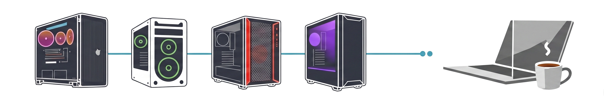
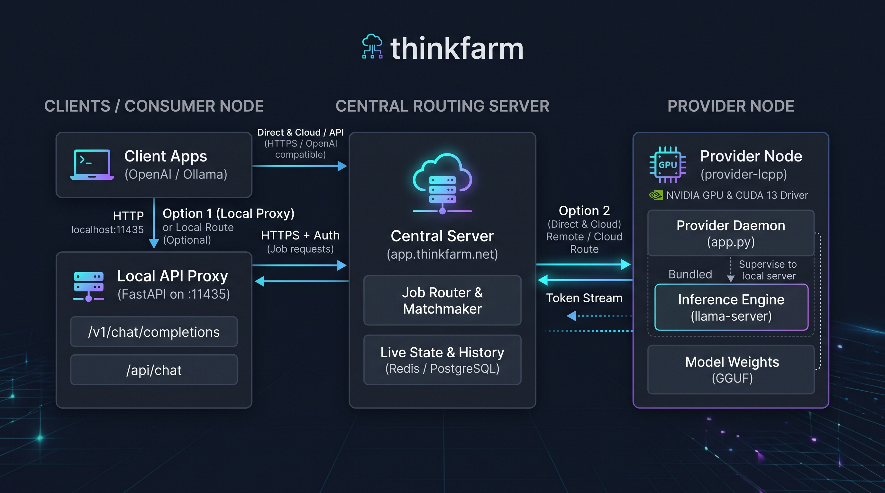
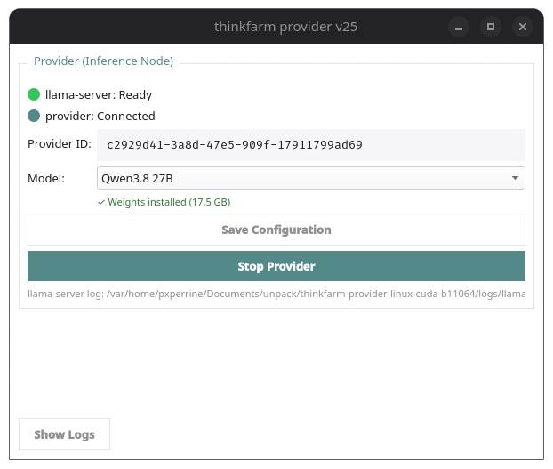

# thinkfarm



A distributed LLM inference system: **provide** GPUs to the network and **consume** models from it through a single **OpenAI-compatible API** (plus an Ollama-compatible surface).

You do not install a client. Any app, agent or script that speaks the OpenAI API points directly at `https://app.thinkfarm.eu/v1` and authenticates with a **Client ID** (`cid`) as the API key.

This repo ships the two provider apps:

| App | Pool it serves | What it does |
|---|---|---|
| **`provider-lcpp`** | **Shared public pool** | Self-contained provider node: spawns and supervises its own bundled `llama-server` (llama.cpp, CUDA 13 / Vulkan), downloads verified GGUF weights, and lends your GPU to the community pool to earn credits. No Ollama or CUDA toolkit required. |
| **`mirror`** | **Private pools** | Lightweight bridge between an inference engine you already run (llama-server, vLLM, Ollama, LM Studio, …) and thinkfarm. Same provider WebSocket protocol as `provider-lcpp`, but it bundles and spawns nothing — you keep your own engine, models and config. |

## Pools: public and private

Every **Provider ID** (`pid`) and **Client ID** (`cid`) belongs to exactly one pool — either the shared public pool, or one of the private pools you create on [thinkfarm.eu](https://www.thinkfarm.eu) (Client IDs / Provider IDs pages, **"+ Create Private Pool"**). A request is only ever routed to providers in the pool its Client ID belongs to; nothing crosses pools.

| | Shared public pool | Private pool |
|---|---|---|
| **Who runs your prompt** | Community GPUs running `provider-lcpp` | Only your own machines running `mirror` |
| **Models available** | Curated catalog of verified models (`GET /v1/models` filters unverified/hidden ones) | Anything online on your providers — custom fine-tunes, arbitrary GGUFs, any quant. No verification, no hidden filter |
| **Provider app** | `provider-lcpp` (bundled `llama-server` + verified model downloads) | `mirror` (bridges your existing `/v1` engine) |
| **Cost** | Per-model token rates (compute factor × `€2.00` / 1M completion tokens, prompts at 30 %), with throughput penalties | Flat transit rate: `€0.10` / 1M completion tokens and `€0.03` / 1M prompt tokens (defaults), any model, no penalties |
| **Provider payout** | Providers earn credits (withdrawable) | `€0.00` — you are paying only for transit to your own hardware |
| **Sharing** | Your account | Hand out a Client ID from that pool; anyone holding it can use the pool. Isolation relies on the secrecy of the 128-bit `pid` / `cid` UUIDs |
| **Network stats** | Model performance, demand charts, throughput baselines | Excluded — private jobs and models never touch public network statistics |

A private-pool provider connects with an **outbound** WebSocket, so no inbound ports, no public IP, no reverse proxy on your machine. If your `ProviderId` or its pool is deleted, the live connection is revoked on its next heartbeat. An account balance of `€0` deactivates that account's Client IDs in **both** pools until topped up.

> The old `consumer` local-proxy app is gone — clients talk to the central server directly, and standard OpenAI-compatible clients need no changes for private pools.

## Architecture

There are three moving parts: a **central server** (`app.thinkfarm.eu`) that clients call directly and that routes inference jobs, and **provider nodes** that run inference on their own hardware. `provider-lcpp` bundles its inference engine and spawns its own `llama-server` child process; `mirror` points at an engine you started yourself. Neither is a proxy for a third-party hosted service.



**The central server.** Multiple stateless FastAPI instances sharing live routing state in a Redis/Valkey cluster: provider status, per-model idle sets scored by context window, and active-job tracking. Every routing key is namespaced by pool (`model:idle:zset:<digest>` for the public pool, `pool:<uuid>:model:idle:zset:<digest>` for a private one), so a private pool's models and providers are invisible to the public pool and to other private pools. Provider and Client IDs are resolved fail-closed against PostgreSQL — a database hiccup never silently drops a private ID into the public pool. Completed jobs (provider, model, pool, token counts, duration) are persisted to PostgreSQL for history, performance analytics, and billing.

**Data flow:**

1. **Client** sends a request straight to the central server — e.g. `POST https://app.thinkfarm.eu/v1/chat/completions` with `Authorization: Bearer <cid>` (or `X-Consumer-ID: <cid>`, or `x-api-key`).
2. The server resolves the Client ID to its **pool**, resolves the model name (or alias) to a content digest **within that pool**, and — when no context size was specified — estimates a safe `num_ctx` from the request body so long prompts aren't silently truncated by provider defaults.
3. It queries the pool's Redis idle set for providers whose context window fits, dispatches the job over each candidate's WebSocket (up to 7), runs a short accept race so competing acceptances are drawn fairly, and assigns the winner along with the endpoint and request body. If no idle provider accepts in time it falls back to busy/higher-context providers; if the first token doesn't arrive within ~90 s it cancels that job and retries on another provider (up to 3 attempts).
4. The **provider** executes the job on its own GPU — `provider-lcpp` against its bundled `llama-server` child, `mirror` against your upstream engine via its OpenAI `/v1` surface — translating Ollama-format jobs into llama.cpp's OpenAI-compatible API as needed, and streams tokens back over the WebSocket in ~75 ms batches.
5. The server relays chunks back to the client (SSE for OpenAI endpoints, NDJSON for Ollama ones). When the provider reports `job_done` with token counts, the server records a job row — including its `pool_id` — for history, analytics and settlement.

## Quick Start

### Prerequisites

- A [thinkfarm.eu](https://www.thinkfarm.eu) account, for Client IDs, Provider IDs, private pools and credit balance.
- **For `provider-lcpp`:** Linux x86_64 or Windows, with an NVIDIA driver supporting CUDA 13 (driver 580+/590+) or a Vulkan-capable GPU. No CUDA toolkit or Ollama installation is required; runtime libraries and binaries are self-contained. **Python 3.10+.**
- **For `mirror`:** anywhere Python 3.10+ runs (Linux, macOS, Windows), plus an inference engine already serving OpenAI `/v1` endpoints.

### Consume (no install)

Create a Client ID on the **Client IDs** page — inside *Shared Public Pool*, or inside one of your private pools — then use it as the API key of any OpenAI-compatible tool.

```bash
# Which models can this Client ID's pool serve?
curl -H "Authorization: Bearer <CLIENT_ID>" https://app.thinkfarm.eu/v1/models

curl -s https://app.thinkfarm.eu/v1/chat/completions \
  -H "Authorization: Bearer <CLIENT_ID>" \
  -H "Content-Type: application/json" \
  -d '{"model": "qwen3.8-27b", "messages": [{"role": "user", "content": "hello"}]}'
```

Ollama-style clients work the same way (`/api/chat`, `/api/generate`, `/api/tags`, …), and Anthropic-style tools can point `ANTHROPIC_BASE_URL` at thinkfarm with the Client ID as the auth token.

### Provide to the public pool (`provider-lcpp`)

Self-contained: it manages its own `llama-server`, handles model weight downloads, and runs either as a full PyQt6 GUI dashboard or as a headless CLI daemon.

```bash
cd provider-lcpp

# 1. Start the PyQt6 GUI dashboard (default)
./thinkfarm.sh

# 2. Or run as a headless background daemon
./thinkfarm.sh --headless

# 3. Download model weights directly from the CLI
./thinkfarm.sh --download --model qwen3.6-35b
```

Create a Provider ID in the *Shared Public Pool* section, paste it into the dashboard, and the node starts accepting public jobs. Public-pool models are benchmarked against network throughput baselines (nodes are pulled out of routing during verification rounds), and a job that runs below a model's baseline is not charged to the consumer.

#### One-command launcher (`thinkfarm.sh`)

Detects or creates a Python virtual environment (`./venv`), installs the runtime deps (`httpx`, `websockets`, plus `PyQt6` for the GUI), and falls back to bundled offline wheels when present.

| Command | Description |
|---|---|
| `./thinkfarm.sh` | Launch the PyQt6 GUI dashboard (closing the window minimizes to the system tray; **Exit** quits). |
| `./thinkfarm.sh --headless` | Run as a headless daemon in the foreground (Ctrl+C stops cleanly). |
| `./thinkfarm.sh --download [--model NAME]` | Download required weights for a model with resumable chunked downloads and SHA-256 verification. |
| `--model <NAME>` | Pick the bundled model to load (also `THINKFARM_MODEL` env var, or the GUI dropdown). Default `qwen3.8-27b`. |

#### Bundled models

One model is loaded at a time; each lives in its own folder:

- `qwen3.8-27b/` (default) — `Qwen3.8-27B-UD-Q4_K_M.gguf`, `mmproj-BF16.gguf`, `mtp-Qwen3.8-27B-Q4_0.gguf` (MTP draft model for speculative decoding).
- `qwen3.6-35b/` — `Qwen3.6-35B-A3B-UD-Q4_K_M.gguf`, `mmproj-BF16.gguf`.
- `qwen3.5-9b/` — `Qwen3.5-9B-Q4_K_M.gguf`, `mmproj-BF16.gguf` (MTP baked into the GGUF).
- `spark-x2.6-4b/` — `Spark-X2.6-4B-Q8_0.gguf`.
- `nemotron-3.5-30b/` — `Nemotron-3.5-Lightning-30B-A3B-NVFP4.gguf`.

Pre-built bundles (Linux/Windows, CUDA 13 or Vulkan) are built with `build.sh` — see `provider-lcpp/README-bundle.md` for the bundle layout and GPU-memory notes.

### Provide to a private pool (`mirror`)

Run your own engine as usual (llama-server, vLLM, Ollama, LM Studio …), then bridge it into a private pool. Create the pool and a Provider ID on the **Provider IDs** page, then:

```bash
cd mirror
pip install -r requirements.txt

cp .env.example .env   # edit PROVIDER_ID, UPSTREAM_URL, MODEL_NAME
python3 app.py         # headless proxy + provider (Ctrl+C stops cleanly)
python3 gui.py         # PyQt6 dashboard, config stored in ~/.thinkfarm/mirror.env
python3 test_mirror.py # self-check with a fake engine, no network needed
```

`mirror` publishes `MODEL_NAME`/`MODEL_DIGEST` to the pool, accepts jobs over the same WebSocket protocol as `provider-lcpp`, and mirrors `POST /v1/chat/completions`, `/v1/completions` and `/v1/embeddings` to your engine. It never downloads weights or manages a process — engine restarts stay yours. Private pools skip model verification and speed gates: any model your engine advertises becomes immediately visible on `/v1/models` to Client IDs in that pool.

> `PROVIDER_ID` must be unique and live: thinkfarm rejects a second connection with the same ID, so don't run `mirror` with the same ID as a running `provider-lcpp`.

## Configuration

### `provider-lcpp` (`custom.ini`, next to the app)

```ini
[provider]
provider_id = <your Provider ID from the Shared Public Pool>
slots = 2
models_path = /mnt/persist/models
llama_args = --ctx-size 262144
```

- `SLOTS` — concurrent jobs, also sets llama-server's `--parallel`; each slot needs its own KV cache.
- `MODELS_PATH` — relocate where weights are downloaded and loaded from (per-model subfolders are kept).
- `LLAMA_ARGS` — extra flags for the child `llama-server` (e.g. `--tensor-split 57,43`).
- `CENTRAL_SERVER_URL` (env / `.env`, default `https://app.thinkfarm.eu`), `LOCAL_PORT` (pin the child server port), `READY_TIMEOUT` (default `1800` s).

### `mirror` (`mirror/.env` for `app.py`, `~/.thinkfarm/mirror.env` for `gui.py`)

| Key | Meaning |
|---|---|
| `PROVIDER_ID` | Provider ID created **inside your private pool** — must be unique per running node |
| `SLOTS` | Concurrent jobs advertised; `mirror` does not queue, so your engine must handle `SLOTS` parallel requests |
| `UPSTREAM_URL` | Engine base URL, default `http://127.0.0.1:8080` |
| `UPSTREAM_API_KEY` | Forwarded to every upstream call as `Authorization: Bearer <key>` (vLLM/llama-server `--api-key`). Empty = no auth. The caller's own `Authorization` header is never forwarded |
| `UPSTREAM_MODEL` | Model id sent to the engine. Empty = the single id the engine advertises; if it advertises several, names pass through unchanged |
| `MODEL_NAME` | Name published to the pool (what your Client IDs ask for). Empty = engine's own id |
| `MODEL_DIGEST` | Digest published for that name. If jobs are ignored, the log prints the digest the server asked for and the digests you offer — copy it here |
| `lccp_context` | Context window advertised for job acceptance; engines that don't report `n_ctx` (e.g. Ollama) otherwise fall back to 8192. `-1` = unlimited |
| `UPSTREAM_TIMEOUT` | Per-request upstream timeout (default 600 s) |
| `LOCAL_HOST` / `LOCAL_PORT` | `mirror` listen address (empty or 0 = free port) |
| `CENTRAL_SERVER_URL` | Default `https://app.thinkfarm.eu` |

## Central server API

Reached directly at `https://app.thinkfarm.eu`, authenticated with a Client ID as `Authorization: Bearer <cid>`, `X-Consumer-ID: <cid>` or `x-api-key`. Which models you see and which providers can serve you is decided by that Client ID's pool.

### OpenAI-compatible

| Endpoint | Method | Description |
|---|---|---|
| `/v1/chat/completions` | POST | Chat completions (streaming supported) |
| `/v1/completions` | POST | Legacy text completions |
| `/v1/responses` | POST | OpenAI Responses API |
| `/v1/messages` | POST | Anthropic-style messages |
| `/v1/models` | GET | List models visible to this Client ID's pool (public pool applies the verified catalog; a private pool lists everything online in it) |

### Ollama-compatible

| Endpoint | Method | Description |
|---|---|---|
| `/api/chat` | POST | Chat with messages |
| `/api/generate` | POST | Generate text / completion |
| `/api/embed`, `/api/embeddings` | POST | Generate embeddings |
| `/api/show` | POST | Model details & prompt template |
| `/api/tags` | GET | List available models (public pool) |
| `/api/ps` | GET | Active inference status (public pool) |
| `/api/version` | GET | API version info |
| `/`, `/stats` | GET | Health check / public-pool network stats |

`/api/tags`, `/api/ps` and `/stats` are internal public-pool views and never expose private pools. Private-pool discovery is `GET /v1/models` with your Client ID; a mistyped Client ID returns `401` rather than silently falling back to the public catalog.

## Screenshots

### Provider dashboard (`provider-lcpp`)

Real-time status indicators (child server, WebSocket connection, worker state), model selector, weight downloader with progress bars, configuration settings, and activity logs.



`mirror/gui.py` uses the same dashboard style (config form left, activity log right, status dots, tray icon) for the private-pool bridge.

## Internals

### `provider-lcpp`

| File / Directory | Purpose |
|---|---|
| `thinkfarm.sh` / `thinkfarm.bat` | One-command launcher with virtualenv bootstrap, offline wheel fallback, and CLI argument parsing. |
| `build.sh` | Builds the self-contained Linux/Windows CUDA & Vulkan bundles. |
| `gui.py` | PyQt6 dashboard: configuration form, live status dots, model selector, download manager, log viewer, system tray. |
| `app.py` | Headless daemon & process supervisor: spawns the child `llama-server`, waits for readiness, handles signals, routes WebSocket jobs. |
| `downloader.py` | Resumable chunked model downloader with HTTP Range requests, SHA-256 verification, disk-space pre-checks. |
| `lcpp/` | Provider client implementation, WebSocket protocol (`provider-protocol.md`), config loader. |
| `<model>/` | GGUF weights per model (`qwen3.8-27b/`, `qwen3.6-35b/`, …) with their run scripts. |
| `bin/`, `cudart/` | Bundled `llama-server` + runtime libraries in an unpacked bundle (older bundles: `llama-b11064/`, `cudart-llama-…-cuda-13.3-x64/`). |

### `mirror`

| File | Purpose |
|---|---|
| `app.py` | FastAPI proxy + provider client: mirrors `/v1/*` to `UPSTREAM_URL` and runs the provider WebSocket in the same process. |
| `gui.py` | PyQt6 dashboard on top of `app.py` (same worker flow in a thread), reads/writes `~/.thinkfarm/mirror.env`. |
| `config.py` | `.env` loader for mirror + provider settings. |
| `provider_client.py` | Vendored copy of `provider-lcpp/lcpp/provider_client.py` — the protocol is identical by construction. |
| `test_mirror.py` | Offline self-check against a fake engine. |
| `thinkfarm-mirror.spec` | PyInstaller spec for the single-file `thinkfarm-mirror` GUI build. |

`provider_client.py` and `config.py` are duplicates, not symlinks: if `provider-lcpp`'s protocol code changes, re-copy them.

---

Built with ❤️ for local LLM enthusiasts.
